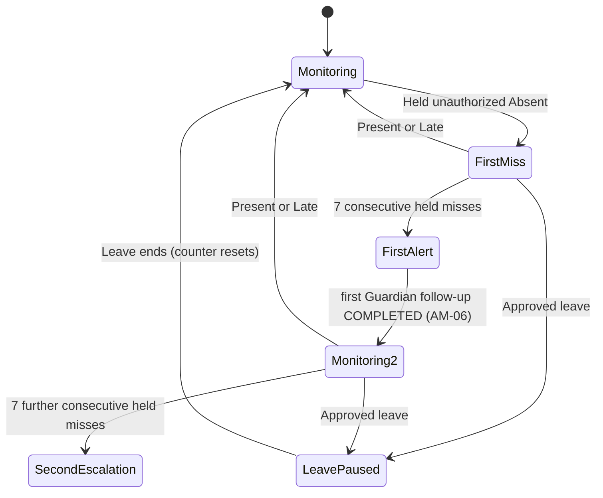

# STATE — Domain State Machines Skeleton

**Status:** DRAFT. Proposed transition labels should not be read as historically approved statuses unless source decision supports them.

## Separation invariant
Attendance status, leave approval, follow-up case, class session, report, payment confirmation and invoice balance **MUST NOT share one state field**.

## Class Session [draft]
`scheduled -> in_progress -> ended`. Alternative `scheduled -> cancelled/rescheduled` only via Zimmadar D-048. Makeup linked to original cancelled session D-050..052. End is idempotent.

## Class Report [source-driven]
`draft -> submitted -> [approved | returned_with_reason]`; `returned_with_reason -> revised_draft -> resubmitted -> approved`. Batch Zimmadar approval D-033/D-044; store revision history. Publication visibility rules [PENDING].

## Attendance & Leave
Attendance: `Present | Absent | Late` D-054; exactly 15 minutes delay = Present; strictly greater than 15 = Late D-055.
Leave: `requested -> approved/rejected`, extension requires Department Supervisor D-067..075. Approved leave still `Absent` in attendance, pauses automatic absence follow-up, resets absence counter when leave ends D-072..073.

## Unauthorized Missed-Class Streak [2026-10-30 approved clarification]
Eligible event: **actual held class**, learner did not join / `Absent`, absence is unauthorized/unapproved (not valid approved leave). Do not count cancelled, upcoming or unheld class sessions.
- First qualifying missed held session: `streak = 1`; each next qualifying consecutive held missed session increments.
- At `streak = 7`: first absence alert / guardian follow-up (D-019, D-056).
- Following **COMPLETION of the first follow-up** (AM-06), **another 7 consecutive qualifying missed held sessions** -> second escalation (D-057); **not 7 calendar days**.
- Present or Late breaks the continuous unauthorized absence streak. Approved leave pause/reset according to D-072..073. Exact post-follow-up transition edge cases are in `OPEN_QUESTIONS.md`.
- AM-09:count independently per enrollment. AM-15:only held classes within effective enrollment interval;exact transfer/session boundary still pending.

## Monthly low-attendance warning (separate engine)
`(Present+Late)/HeldClasses*100`; approved-leave Absent still in denominator D-084. Current calendar month D-095; no warning until >=3 held classes D-096; warning below 75% D-085, with repeat, pending-case and closure logic D-087..111.

## Follow-up / escalation [PENDING FULL MODEL]
Repeated warnings, reopen cap 2, teacher reassignment, supervisor action plans, blocker severity SLA and management overrides are detailed in D-087..131; do NOT simplify to one boolean `overdue`.

## Payment [integration only]
Payment claims/verification statuses originate from legacy payment portal. Academy may display mirrored verified status and separately track invoice balance; no new payment confirmation source.

## Detailed attendance/follow-up design v1.4
See `design/attendance_followup/README.md` for current draft. AM-12 pauses warning/follow-up and resumes remaining deadline;AM-13 defines prior-month low-attendance closure after new-month>=3 held and>=75%;AM-14 allows postleave Late as Returned;AM-15 scopes to effective enrollment. The compact old diagram is not a complete leave/reset case-lifecycle model;AFQ-06 remains unresolved. Full other-domain state machines are still draft.

## Report state detail v1.5
`design/report_workflow/WORKFLOW_STATES_DEADLINES.md` separates lifecycle,initial submission compliance,review duty and escalation. Timely submitted AwaitingReview is not missing/late for Teacher reminders AM-17. Revision/reviewer deadlines remain pending unless explicitly approved. Other attendance state design unchanged.
