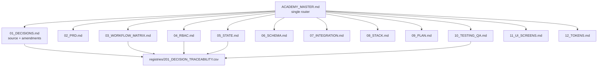

# IOM School Maktab — Academy Vault Starter v1.0

**Purpose:** An auditable, decision-driven starter vault to prevent accidental requirement invention, duplicate business rules, destructive overwrites and lost architectural context.

**Vault assembly date:** 2026-10-30 (Asia/Dhaka). **Status:** DOCUMENTATION STARTER / NOT APPROVED FOR CODING.

## How to start
1. **Read `ACADEMY_MASTER.md` first**. Both `AGENTS.md` and `CLAUDE.md` route to that master file.
2. Read the **unchanged** `references/IOM-School-Maktab-Reference-v1.0.md`. It is the source for Decisions 1–201, and keeps the 12 proposed enhancements unapproved.
3. Read `01_DECISIONS.md` + `DECISION_AMENDMENTS.md` for *explicit user clarifications and approvals*, **not** silent edits to original wording.
4. Consult `OPEN_QUESTIONS.md`; resolve required blockers with user before treating them as approved policy.
5. When touching any feature, link Decision ID -> Workflow -> RBAC -> State -> Schema -> Test. Use `registries/201_DECISION_TRACEABILITY.csv`.
6. Run `python tools/validate_vault.py` from the vault root to verify document consistency; this is a **documentation integrity check only**, not a system/code security audit.

## Important status vocabulary
- `SOURCE_CONFIRMED`: confirmed **within user-supplied source**, individual historical approval evidence not independently available.
- `USER_CLARIFIED`: explicitly clarified by user in current planning conversation; preserve original source text and cite amendment.
- `USER_APPROVED`: explicitly approved by user in planning conversation; scope must be exact.
- `PROPOSED`: assistant suggestion, not accepted.
- `PENDING`: awaiting user/authorized management decision.
- `BLOCKED`: cannot implement safely without dependency/decision.
- `IMPLEMENTED/TESTED/RELEASED`: require actual evidence (commits, tests, UAT, releases); **none claimed here**.

## Source file hash
`SHA256: 9cd4e5cb15b7e3c2dfd73d968f1ec83069cf02b3f75642453a51a684d17bde96`

## Scope guard
- 201 source decision rows remain fixed in `references/`. No original source text rewritten.
- The 12 proposed enhancements are NOT automatically MVP scope.
- The 18 main / 60 sub-workflow catalog is **draft and incomplete**; do not freeze counts.
- Existing 1:1 Class Manager and separate payment portal **must not be modified** by this starter vault.
- The new 1:1 integration is user-approved **read-only** (approved Oct 30, 2026 planning conversation); implementation feasibility still pending.
- Production data, deployment, schema migration, and code changes require independent authorization and review.

## Simplified vault map

*`AGENTS.md` and `CLAUDE.md` are instruction entrypoints, not independent policy sources.*
