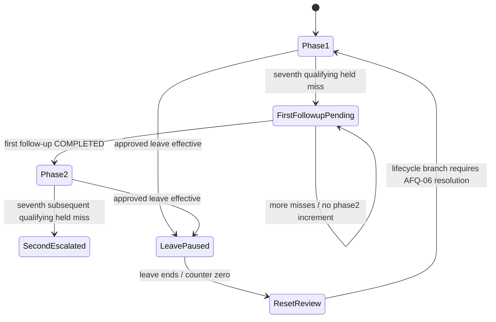

# State, counters ও event ordering — DRAFT DESIGN

Basis: D-019/040/041/053–131/148/158; AM-01/02/06/09/12–15। Pending details: `QUESTIONS_AND_GATES.md`। নিচের technical labels প্রস্তাবিত; মানুষের workflow authority source থেকে আসে।

## 1. আলাদা state dimensions

| Aggregate | Candidate state/dimension | Evidence / boundary |
|---|---|---|
| ClassSession | Scheduled, InProgress, Ended, Cancelled, Rescheduled; `held_evidence` আলাদা | Ended একাই held policy-এর সব edge case সমাধান করে না; AFQ-02 |
| AttendanceEntry | Present, Absent, Late | D-054; unknown/unrecorded import quality flag আলাদা, চতুর্থ production attendance status নয় |
| LeaveRequest | Requested, Rejected, Approved; coverage/effective interval আলাদা | D-067–075; approval ও date interval এক জিনিস নয় |
| AbsenceCounter | Phase1, FirstFollowupPending, Phase2, SecondEscalated; LeavePaused overlay | D-019/056/057; AM-06 completion gate |
| MonthlyAttendance | held_count, present_count, late_count, percentage, calculation_month | D-084/095/096; AM-15 enrollment interval |
| FollowupCase | Pending, Completed, Closed; `kind`, `cycle_kind`, `escalation_tier`, `overdue`, `pause` পৃথক | D-098 dashboard labels computed; Overdue/Escalated সব lifecycle state নয় |
| FollowupNote | Versioned submission + correction approval state | D-089–092; private content |
| ActionPlan | Requested, Draft, Submitted, Returned, Approved, InProgress, Completed | D-113–124; final completion authority/detail unresolved |
| Blocker | Open, Assigned, Resolved; severity, escalation, due clock আলাদা | D-125–131; কে resolution confirm করবেন AFQ-11 |

Followup kind কমপক্ষে `UNAUTHORIZED_ABSENCE` ও `LOW_ATTENDANCE`; শুধু দ্বিতীয় kind-এ D-094/AM-13 percentage auto-close প্রযোজ্য। Reopen/advanced chain D-097–131 low-attendance source family-এর জন্য নিশ্চিত; একই নিয়ম absence case-এ নির্বিচারে প্রয়োগ নয় (AFQ-05)।

## 2. Class এবং attendance eligibility

Candidate eligibility gate:

`verified actually held class AND linked enrollment effective for that session AND usable verified attendance`

- Scheduled-only/cancelled/future/unheld session কোনো missed-class increment বা held denominator নয়।
- Provider/API payload provisional evidence; D-053 অনুযায়ী Teacher verification প্রয়োজন।
- Unknown/unrecorded attendance-কে Absent বানানো যাবে না। Held class আছে কিন্তু final attendance নেই: completeness gap দেখাতে হবে; official percentage release policy AFQ-10, approved figure বলে publish নয়।
- Late: join >15 minutes after class start; exactly15 Present (D-055)। কোন start timestamp anchor ব্যবহার হবে AFQ-04।
- Enrollment A/B counter কখনো person-wide sum নয় (AM-09)। একই দিনের multiple real sessions-কে silently একটি day-event করা নয়; overlap/order/transfer edge AFQ-08।
- Teacher absence approval নিজে Zimmadar-এর reschedule/cancel authority নয় (D-048/195); exact held evidence policy AFQ-02।

## 3. Unauthorized absence counter

| ID | Current / event | Guard | Proposed effect | Authority |
|---|---|---|---|---|
| ST-01 | Phase1 + eligible unauthorized Absent | Verified held; outside approved leave; relevant enrollment | Increment phase1;1..6 no threshold alert | D-019/056;AM-01/09 |
| ST-02 | Phase1 -> 7th qualifying consecutive miss | Same eligibility;threshold crossing new for evidence version | Create first alert for Zimmadar and assigned Teacher guardian-contact task;FirstFollowupPending | D-056 |
| ST-03 | FirstFollowupPending + more missed classes | First follow-up NOT completed | Do NOT advance phase2;retain attendance facts | AM-06 |
| ST-04 | First follow-up completion event | Authorized completed evidence;exact completion mechanism AFQ-05 | Phase2 count starts0;only subsequent eligible held classes count | AM-06 |
| ST-05 | Phase2 + qualifying miss1..6 | Session after completion cutover;ordering clear | Increment phase2 without second escalation | AM-02/06/09 |
| ST-06 | Phase2 -> qualifying miss7 | No intervening break/leave;new threshold crossing | Zimmadar reminder + Supervisor escalation;SecondEscalated | D-057;AM-02/06 |
| ST-07 | Any monitoring phase + Present/Late | Final verified attendance | Continuous unauthorized streak breaks;case-history side effects AFQ-06 | Existing v1.3 state baseline;D-019/056 scope |
| ST-08 | Approved leave effective | Authorized approved coverage | Pause absence follow-up/escalation;do not increment;history retained | D-072 |
| ST-09 | Approved leave ends | Effective leave interval over | Reset absence counter to0;case phase/resume lifecycle after existing first completion AFQ-06 | D-073 |
| ST-10 | Corrected source attendance | Authorized correction | Recompute dependent counter;close unnecessary pending follow-up alerts;do not erase evidence | D-082;retroactive leave specifics AFQ-03 |

After SecondEscalated,source does not define an automatic third7-class escalation or endless repeated first alerts. Preserve events;do not invent third stage. First pending/completed case is not deleted by a new phase. Whether Present/Late auto-closes a still-valid contact task is not granted by the streak reset alone.

The last arrow is a labelled unresolved design branch,NOT a policy that always recreates a first-case workflow after leave. Production transition must be blocked until AFQ-06 is resolved. Diagram is a reading aid;transition table and policy references govern.

## 4. Leave and return

1. Primary/Secondary Guardian submits official portal notice for linked child;Telegram-only not official (D-066/067).
2. Validate class-before notice or emergency submission <= class-end+24h;range still observes each past-class deadline (D-070/071);notice <=14 calendar days D-074.
3. Only Batch Zimmadar Approve/Reject;written rejection reason;resubmission keeps revisions (D-068/069).
4. Extension beyond14 days:Zimmadar review then Department Supervisor final approval D-075;overlap/extension effective boundaries AFQ-08.
5. Effective approved leave:Attendance remains Absent for a held class missed on leave;percentage continues,warning/follow-up automation paused (D-072/084;AM-12). Do not overwrite an actual Present/Late merely because a leave interval overlaps;contradictory evidence is a review conflict.
6. Save remaining low-attendance follow-up time before pause;resume remaining after leave,not a fresh3-day window (AM-12). Already overdue cases,multiple leave intervals,weekly cadence and action-plan/blocker clock coverage are not silently resolved;see TIMERS and AFQ-09.
7. Leave end:absence counter resets D-073. First verified postleave attendance Present OR Late marks Returned AM-14;no form/return notice D-077/078. A missed return class stays Absent;no return claim.
8. Historical late leave approval/rejection,withdrawal of approval,and retention of delivered alerts require AFQ-03 before automated replay.

## 5. Monthly low-attendance calculation and cases

For each enrollment and Bangladesh calendar month,only relevant held classes during effective enrollment (AM-09/15):

`attendance_percentage = 100 * (Present + Late) / Held`

Approved-leave held Absent remains denominator. `Held=0` has no computable percentage;proposed display “ক্লাস হয়নি”,not0% or100%. Missing verified attendance is a completeness gap,not a fabricated absence. Display rounding policy is technical draft;compare exact counts rather than rounded percentage to avoid74.999 becoming75.

| ID | Condition/event | Effect | Basis |
|---|---|---|---|
| MO-01 | held_count <3 | No LOW_ATTENDANCE warning | D-096 |
| MO-02 | held>=3 and percentage<75 and no effective approved leave pause | Warning to Guardian,Class Teacher,Zimmadar;create Teacher follow-up due3 days | D-085–087;AM-12 |
| MO-03 | Percentage still<75 after7-day repeat cadence | New warning and follow-up cycle;old case not overwritten | D-093;cadence pause anchor AFQ-09 |
| MO-04 | Current-month percentage>=75 | Close applicable pending LOW_ATTENDANCE cases;retain history | D-094;sample guard and prior-month detail AM-13 |
| MO-05 | Month rollover | Start new monthly summary;carry existing pending cases and their clocks/history | D-095/097 |
| MO-06 | New month held<3 | Do not close previous-month pending cases just from new-month percentage | AM-13 |
| MO-07 | New month held>=3 and percentage>=75 | Close previous-month pending LOW_ATTENDANCE only;not absence cases or ActionPlan/Blocker | AM-13 |
| MO-08 | Approved leave active | Continue visible calculation;hold warning and automatic follow-up/escalation | AM-12 |

Same-month percentage correction dropping sample below3,warning repetition spanning leave/month boundary,and whether a reopened case counts as “pending” for auto-close need explicit modelling AFQ-09/10. Do not declare implementation-ready in these branches.

## 6. LOW_ATTENDANCE follow-up lifecycle

| ID | Event | Guard / effect | Basis |
|---|---|---|---|
| FU-01 | Assigned Teacher submits valid contact note | Contact date,Guardian statement,next steps;auto Completed;retain private notes | D-089/090/102 |
| FU-02 | Edit note | Own authorized case;24h from submission then Zimmadar approval;version history | D-091/092;precise inclusive boundary AFQ-07 |
| FU-03 | Optional reminder acknowledgement | Records receipt only;does not complete case | D-101/102 |
| FU-04 | Complete case reopened | Teacher within24h of completion;later Zimmadar permission;cap2 | D-103/106;boundary AFQ-07 |
| FU-05 | Reopen accepted | Increment reopen count;Pending cycle REOPENED;due24h from reopen | D-104/105 |
| FU-06 | Third reopen attempt | Denied;Teacher may request NEW case for Zimmadar review/create/approve | D-106/107 |
| FU-07 | New case approved | Separate linked case,due3 days;3-day reminder and6-day escalation | D-108/109 |
| FU-08 | Supervisor reassigns escalated case | New assigned Teacher,due48h;48h reminder + Supervisor,then24h Management | D-110–112 |
| FU-09 | Management intervention | First request Supervisor action plan;may reassign Teacher/change deadline | D-113 |
| FU-10 | Auto-close condition valid | Close case with reason/source snapshot;Completed remains historically completed,not rewritten | D-094/AM-13;D-082 for unnecessary pending alerts |

No arbitrary bulk Complete/Close: D-099 permits bulk reminders only. D-099 does not by itself grant unlimited manual-close power;allowed manual reasons/actors AFQ-11. Reassignment must preserve old assignee/history and revoke obsolete pending jobs in the technical design;historical-note visibility after reassignment AFQ-12.

## 7. Action plan and blocker chain (D-113–131)

- Management requests plan;Supervisor24h;missing plan -> Management alert/reassign (D-114/115).
- New Supervisor/Staff gets12h;further failure -> Management creates/reassigns/emergency action (D-116/117).
- Staff/Supervisor plan requires Management approval;Management-authored no separate approval (D-118).
- Return -> revision12h;late revision -> Management alert/intervention (D-119/120).
- Approved execution owned by Department Supervisor;at least24h progress updates until finished (D-121–124).
- Blocker report alerts Management;Supervisor sets resolver and priority;Management may override (D-125/126/128).
- Critical6h,High12h,Normal24h;Management may change deadline (D-127).
- Critical overdue:Resolver/Supervisor/Management immediately. High/Normal:Resolver reminder+Supervisor alert,another6h -> Management (D-129).
- Escalated blocker Management intervention/reassign/new deadline/direct action D-130;reassigned deadline explicitly Management-defined,not hard-coded D-131.

Plan completion confirmation,blocker resolution authority and postcompletion closure cascade AFQ-11. Student percentage auto-close MUST NOT close action plans/blockers. Student leave must not silently pause Management action-plan or blocker SLAs;scope AFQ-09.

## 8. Proposed transaction/event precedence — not an approved new business rule

Within one aggregate,authorize -> lock/version-check -> persist immutable revision -> recompute from authoritative facts -> persist derived case effect + outbox atomically. Proposed order when events collide:resolve approved effective coverage and evidence version before deriving counters;do not issue contradictory notifications from stale projections. Completion/edit/reopen at exact same instant as class or deadline remains AFQ-07/08;queue order alone cannot set business policy.
