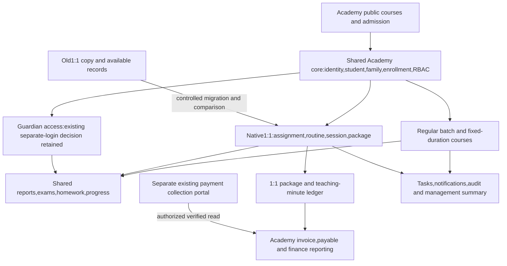

# Main Academy-র সঙ্গে native1:1 module — proposed plan v1.7

## সিদ্ধান্ত ও প্রস্তাবের পার্থক্য

**নিশ্চিত নতুন নির্দেশ AM-18:**আগের1:1 অপরিবর্তিত রাখার বাধা প্রত্যাহার;main system-এর সঙ্গে সামঞ্জস্য রেখে নতুন করে design/planning ও execution plan। **নিচের architecture,commercial policy ও delivery choices প্রস্তাব**;plan লেখা approval/final freeze বা live পরিবর্তন নয়।

## 1. প্রস্তাবিত architecture

একই Academy application-এর মধ্যে স্পষ্ট দায়িত্বের1:1 module। Shared identity/Student/Family/Course/Enrollment/RBAC/Academic progress/notification/audit/reporting;1:1-specific package contract,schedule,Teacher assignment,actual session and minutes ledger। এক student আবার তৈরি নয়;একাধিক course enrollment আলাদা।

Modular monolith ও shared logical relational model প্রস্তাব;exact runtime/framework/database version এখনও নির্বাচিত নয়। পুরোনো PHP ZIP নতুন পুরো Academy-র stack নির্ধারণ করবে না। Current local package has Node>=24 declaration/server.cjs and earlier prototype;not proof of production readiness. Rebaseline actual code,tests and hosting before final stack decision;old PROJECT-STATUS text can be stale. No new framework installation/rewrite in this task.

## 2. কোনটি shared,কোনটি1:1-specific

| Shared Academy service |1:1 module responsibility |
|---|---|
| Student/family/identity and separate enrollments |One enrollment's one-student tuition arrangement;teacher can change with history |
| Staff accounts,multiple roles,branch/department authorization |Effective-dated primary/substitute Teacher assignments per session |
| Admission/assessment and course catalog |Choose1:1 delivery and proposed package during enrollment |
| Calendar/session primitives |Recurring individual slots,occurrences,time changes and conflict review |
| Class timer,attendance and course report engine |1:1 session context and actual package consumption rules |
| Exams/homework/academic progress |Show same enrolled student's1:1 progress alongside other courses |
| Invoice/verified-payment mirror/Teacher payable |1:1 package charge basis and reconciled actual teaching-minute evidence |
| Task/notification/audit/Management reporting |1:1 due hours,next classes,unreported classes,unallocated Teacher queues |

Public website দেখাবে1:1 course/delivery details ও admission entry;operational1:1 module থাকবে authenticated portal-এ। Public course copy/fee invent করা হবে না। UI design will follow existing Academy visual system when implementing;no UI redesigned by this planning task.

## 3. Core operational flow

Application/assessment -> existing or new verified Student+Family -> new1:1 Enrollment -> draft PackageContract -> authorized activation -> Teacher assignment -> recurring slots -> concrete ClassSession occurrence -> Start/End -> verified attendance+course report -> report review -> eligible minutes transaction -> package balance+invoice/payable projection -> shared progress/Management view।

Each arrow needs explicit actor,state,scope,evidence and idempotence. “Eligible minutes” is not simply reported manually or charged from a cancelled scheduled slot;policy decisions below control it. Report approval doesn't retroactively overwrite actual start/end history. A repeated End/worker retry must not double-debit minutes or Teacher pay.

## 4. Candidate logical entities and invariants

| Entity | Purpose / invariant |
|---|---|
| Enrollment (shared) |Student/course/delivery/effective interval;per-enrollment attendance/progress,AM-09/15 |
| OneToOneContract / ContractVersion |Package allowance,billing period,fee/effective dates,policy version;old months keep old contract version |
| TeacherAssignment / AssignmentHistory |Who teaches which enrollment/session and when;no free-text teacher identity |
| RecurringSlot / ScheduleVersion / SessionOccurrence |Multiple days/slots permitted as draft technical capability;stable occurrence ID;no person/day uniqueness |
| ClassSession (shared primitive) |Scheduled and actual times,status,meeting link,assignment snapshot;cross-midnight full timestamps |
| Attendance / ClassReport / ReportRevision |Reuse approved source policies and newly designed engines;record-specific correction authority preserved |
| MinuteLedger / AdjustmentApproval |Append-only credit/debit/reversal against contract and session;balance is derived,not overwritten |
| Invoice / PaymentMirror / TeacherPayable |Accounting views distinct from minute balance;verified payment authority remains external |
| LegacyIdentityMap / MigrationRun / ReconciliationRecord |Preserve original source ID/provenance;no blind identity merge |

New entity names are logical proposals,not physical tables/migrations. Precise column types,relationships,constraints,security model,minute rounding and retention require detailed design. Minutes,fee due and Teacher earnings are separate ledgers;changing one does not silently rewrite the others.

## 5. State model and permissions — starting proposal

- Contract:Draft -> Active -> Paused/Completed/Cancelled;activation,pause,fee adjustment authority must be defined;enrollment lifecycle D-158 remains separate.
- Schedule:Proposed -> Approved/Published -> Changed/Cancelled with effective history. Existing D-048 Teacher request/Zimmadar final change authority is the baseline;any1:1 exception needs explicit approval.
- Session:Scheduled -> InProgress -> Ended;cancel/reschedule/makeup remain separate and linked. Ended is not itself independent meeting-provider verification.
- Report:reuse Draft/Submitted/Returned/Resubmitted/Approved plus independent deadline/review compliance,AM-17. Exact1:1 applicability/exception matrix must be reviewed,not dropped implicitly.
- Minutes:PendingEvidence -> Eligible -> Posted -> Reversed/Adjusted through audited authority;WHEN eligible is a pending product rule,not decided by these enum labels.
- Teacher:only assigned session's timer/attendance/report;Zimmadar approvals per source;Supervisor/Management act within scope;Finance powers need specific matrix.
- Guardian:own children/progress/schedule/leave/fee status only;private follow-up notes excluded. No student login added in first version.

AM-19 approves one Academy Guardian login/dashboard across linked children and Batch/1:1. Primary and Secondary retain separate identities and role restrictions. Account-linking/recovery/session migration needs explicit technical design;no automatic legacy password merge or shared credentials.

## 6. Policies needed to finalize before affected code

| ID | Decision to settle | Candidate direction,not approval | Blocked behavior |
|---|---|---|---|
| OTO-01 |Package/business model |Start by representing monthly minute allowance/current confirmed business terms;do not invent fees or unlimited plans |Contract activation/invoice generation |
| OTO-02 |When teaching minutes consume package |Use authorized verified actual session evidence;report-approval gate and corrections must be explicitly chosen |Minute posting and Teacher pay |
| OTO-03 |Student missed class vs Teacher cancellation vs makeup |Separate factual session outcomes;billable/deductible/carry-over/refund policy requires explicit answer |Commercial deductions/makeup balances |
| OTO-04 |Carry-over,expiry,overrun,proration,pause |No guessed default;effective-dated approved parameters |Month rollover/contract changes |
| OTO-05 |Time zones and recurring slots |Keep Bangladesh policy clocks;international local display/DST remains original unapproved proposal unless approved |International recurring schedule interpretation |
| OTO-06 |Guardian login target |AM-19 resolves unified Guardian target;technical auth/account-linking/session design still pending |Auth/navigation implementation |
| OTO-07 |Self-service reschedule and Teacher substitution |Existing Zimmadar final authority unless explicitly changed;slots/notice/availability policy pending |Schedule-change endpoints |
| OTO-08 |Shared attendance/report policy applicability |Map every relevant approved D-ID and existing AFQ/RQ pending branch to1:1;document exceptions for approval |Auto alerts/report deadlines for disputed cases |
| OTO-09 |Financial/contract/minute override powers |Specific role/action/reason/audit requirements;not blanket Admin power |Manual commercial corrections |
| OTO-10 |Current records,migration date and opening balances |Anonymized samples and source mapping;approved reconciled opening package/fee balances |Production import/cutover |

## 7. Migration and ownership transition

Old copy remains migration/reference evidence while new module is built separately. No requirement to preserve its defective data model or missing Guardian implementation. Available old records are not invented;no historical attendance/report approval inferred from manual minutes or free-text notes.

1. Inventory current source/schema and relevant existing data,make verified backup before any real migration;schema needed for mapping,not a dependency for new module architecture work.
2. Define Student/Family/Teacher/enrollment mapping;ambiguous names/contacts require review. Credentials/password hashes not copied as presumed compatible identity.
3. Dry-run import in isolated DB,retain source IDs,counts,FKs,manual provenance and reconciled hours/fees. Historical missing states labelled unknown,not backfilled with fake approvals.
4. Define cutover watermark and writer ownership BEFORE parallel operation:legacy remains old operational writer until switch;new module sandbox/test projections reconciled. No two independent editable masters for same active period.
5. For a permitted pilot,explicitly assign which system writes that cohort/date range;freeze or disable relevant old write path only through authorized operational action. Do not rely on informal dual entry.
6. Validate incremental delta/opening balances;switch only after UAT and Central approval. Retain old reference archive and rollback evidence;no deletion by default.
7. Rollback after new live writes must preserve/export/reconcile new transactions and explicitly restore writer ownership;merely returning old code/backup is not safe data rollback. Cutover/reverse-delta procedure must be rehearsed.

## 8. Execution plan

See `EXECUTION_PLAN.csv` for work packages,dependencies and objective exit criteria. Sequence:rebaseline main code+hosting -> policy/data/auth contracts -> shared identity/scope primitives -> complete1:1 academic vertical slice -> approved minutes/finance -> Guardian views -> migration rehearsal -> pilot/UAT -> authorized launch. Academic-first development does not remove required finance/exam/other first-version scope.

A realistic calendar estimate comes after main-code test audit,current schema and OTO-01..10 answers. No unsupported “ready in X days” promise. Planning can advance now;unanswered money/auth policies block only affected implementation,not all documentation.

## 9. Acceptance/readiness criteria

- Same student/family is not duplicated when adding1:1;concurrent enrollment counters stay separate.
- Teacher cannot read/edit another assignment;Guardian cannot access another child;ordinary branch staff cannot cross branch;private notes remain private.
- Timezone/cross-midnight/session replay/correction produces exact audited minutes;no duplicate debit,pay or invoice from retry.
- Contract effective-version change does not reprice historic periods;approved cancellation/makeup/carry-over rules match ledger and invoice independently.
- Report return/revision/review and late compliance match approved shared rules;no hidden reviewer SLA or commercial penalty.
- Separate payment portal is sole collection/confirmation authority;local ledger imports never fabricate verified payment.
- Migration counts,identity links,hours/package balances and fees reconciled;restore and writer-ownership rollback rehearsed.
- All approved first-version required capabilities included;Department/Branch UAT and Central Management final launch approval D-201 recorded.

These are candidate acceptance requirements,not executed application tests. This deliverable finalizes a concrete reviewable plan,not every unresolved business policy or architecture freeze.

## AM-19 — unified Guardian target (v1.7.1,2026-10-31)
New Academy Guardian access uses one login/dashboard across linked children and Batch/1:1 classes/progress. This explicitly supersedes D-169 separate1:1 Guardian login and corresponding AM-05/10/18 preservation language for the NEW target system only. Preserve own-child access,Primary/Secondary distinct identities/permissions,D-090 note privacy and all unrelated approvals. No automatic legacy credential merge,shared password,production migration or SSO implementation approved. OTO-06 target-login choice RESOLVED;technical authentication,migration and account-linking design remain pending. Earlier separate-login statements in this document are historical and superseded only for the new target system.
