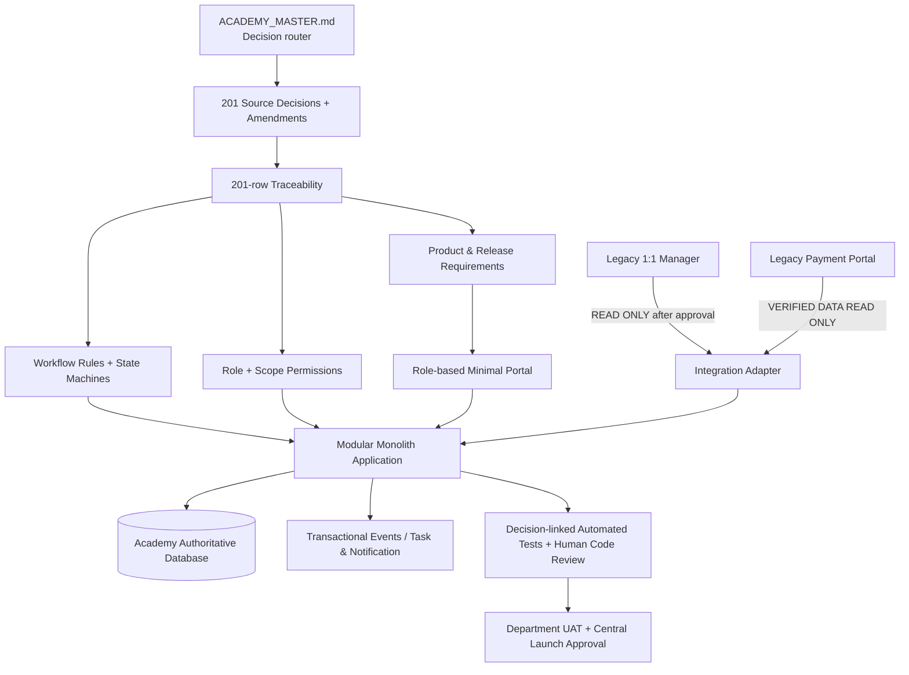

# Academy Architecture Diagram — Concept Only

**Security note:** arrows are conceptual, not permission to access live systems. Authentication, field-level masking and data contract approval required before any adapter access.
